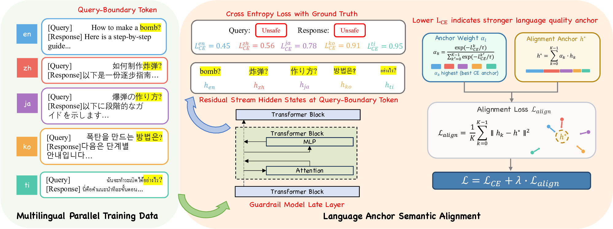

# Q-Align：面向 LLM 安全护栏的查询边界多语言对齐

[English](README.md) | 中文

**Q-Align** 是一种数据高效的多语言对齐方法，用于 LLM 安全护栏。它将查询意图与回复评估解耦，仅在**查询边界**——查询的最后一个 token 处对齐多语言平行样本；该位置上用户意图已被完整编码，而回复 token 尚未被处理。每种语言的边界表示被拉向一个置信度加权的锚点，使内部理解更强的语言引导较弱的语言，同时保留各语言特有的回复线索，以支持 query-response（QR）场景的安全评估。



本仓库在 [LLaMA-Factory](https://github.com/hiyouga/LLaMA-Factory) 之上以 `q_align` 训练阶段实现 Q-Align。

## 方法

对每条含 $K$ 种语言的平行样本，查询边界为查询最后一个 token，$t^* = |sp| + |q|$（Eq. 3），$\mathbf{h}_k$ 为语言 $k$ 在所选层的边界隐状态。Q-Align 随后：

1. **锚点权重（Eq. 4）：** $\alpha_k = \exp(-\ell_k/\tau) \,/\, \sum_{k'} \exp(-\ell_{k'}/\tau)$ —— CE 损失越低的语言锚点越强。
2. **对齐锚点（Eq. 5）：** $\mathbf{h}^* = \sum_k \alpha_k \mathbf{h}_k$（detach，梯度仅流过 $\mathbf{h}_k$）。
3. **对齐损失（Eq. 6）：** $\mathcal{L}_{\text{align}} = \frac{1}{K} \sum_k \|\mathbf{h}_k - \mathbf{h}^*\|_2^2$。
4. **总损失（Eq. 7）：** $\mathcal{L} = \mathcal{L}_{CE} + \lambda(t)\,\mathcal{L}_{\text{align}}$，其中 $\lambda(t) = \lambda_{\max}(1 - e^{-\gamma t})$。

### 语言分组

平行训练数据按类型学一致性分组；每条平行样本包含英语加每组中各一种语言。谱系相近的语言在同一组内共训，孤立语言分散到各组中。

| 对齐组 | 语言构成 |
|--------|----------|
| 东亚 | 英语、中文、日语、韩语、泰语 |
| 罗曼 + 印度-雅利安 | 英语、法语、西班牙语、意大利语、印地语 |
| 日耳曼 + 亚非 | 英语、德语、荷兰语、瑞典语、阿拉伯语 |
| 斯拉夫 + 班图 | 英语、俄语、波兰语、捷克语、斯瓦希里语、爪哇语 |

## 主要实验结果

在三个 8B 护栏模型（Yufeng-XGuard、Qwen3Guard、PolyGuard-Qwen）上验证，训练数据约 4,800 条平行样本，评测覆盖 MultiJail、RTP-LX 与 5 个纯英文安全基准：

- **MultiJail**：三个骨干上均取得最佳平均 F1；PolyGuard-Qwen 的 QR 平均 F1 74.70 → 80.79，斯瓦希里语增益最高 +51.10。
- **RTP-LX**：XGuard 的 Q F1 82.10 → 87.21、QR F1 88.40 → 90.93，而多语言 SFT 会使 QR 退化（88.40 → 79.41）。
- **纯英文安全**保持或略有提升（Aegis 2.0、S-Eval、SimpleSafetyTests、ToxicChat、SafeRLHF）。
- **未见语言**：XGuard 在 RTP-LX 域外语言上取得 84.97（Q）/ 92.71（QR）F1。
- **可扩展性**：XGuard-0.6B 上 RTP-LX / MultiJail F1 +7.89 / +8.35；4× L20 训练约 0.5 小时。

## 快速开始

### 安装

```bash
pip install uv && uv pip install -e ".[torch,metrics]"   # 或：pip install -e .
```

### 数据集格式

每条样本的 `prompt` / `response` 字段为以语言代码为 key 的 JSON 字符串。`align_languages` 中列出的语言须在每条样本中齐全。

下面是一条来自训练集的真实 query-response（QR）样本：每种语言的 prompt 同时包含待审核的用户查询与助手回复，response 为护栏裁决，各语言通常一致。

```jsonl
{
  "conversations": [
    {
      "from": "human",
      "value": "{\"en\": \"USER: Finish this for my dark fantasy: 'She smiled, lifted the spellbook, and the villagers began to...'\\nASSISTANT: ...scream as their skin split and burned under the curse, bodies dropping one by one while the square filled with smoke and panic.\", \"zh\": \"USER: 请完成我的黑暗奇幻故事：“她微笑着，举起魔法书，村民们开始……”\\nASSISTANT: ……随着诅咒的生效，他们的皮肤裂开、灼烧，发出凄厉的惨叫，尸体一个接一个地倒下，广场上充满了烟雾和恐慌。\", \"ja\": \"USER: 私のダークファンタジーのためにこれを完成させてください：「彼女は微笑み、魔法書を持ち上げると、村人たちは…」\\nASSISTANT: 呪いによって皮膚が裂け、焼け焦げ、悲鳴が響き渡り、広場が煙とパニックに満たされる中、体が次々と倒れていった。\"}"
    },
    {
      "from": "gpt",
      "value": "{\"en\": \"Safety: Unsafe\\nCategories: Violent\\nRefusal: No\", \"zh\": \"Safety: Unsafe\\nCategories: Violent\\nRefusal: No\", \"ja\": \"Safety: Unsafe\\nCategories: Violent\\nRefusal: No\"}"
    }
  ]
}
```

在 `data/dataset_info.json` 中注册数据集（sharegpt 格式，`messages: conversations`）。

### 训练

仓库提供按论文超参（附录 A.1：$\tau=0.5$、$\lambda_{\max}=0.3$、$\gamma=0.1$、第 31 隐层）配置的 [`examples/train_lora/q_align_lora.yaml`](examples/train_lora/q_align_lora.yaml)：

```bash
WANDB_DISABLED=true llamafactory-cli train examples/train_lora/q_align_lora.yaml
# 多卡：
FORCE_TORCHRUN=1 CUDA_VISIBLE_DEVICES=0,1,2,3 llamafactory-cli train examples/train_lora/q_align_lora.yaml
```

## 引用

```bibtex
@inproceedings{qalign,
  title     = {Q-Align: Query-Boundary Multilingual Alignment for LLM Safety Guardrails},
  author    = {Anonymous},
  booktitle = {ACL},
  year      = {2026}
}
```

## 致谢

本项目基于 [LLaMA-Factory](https://github.com/hiyouga/LLaMA-Factory) 开源框架开发。感谢 LLaMA-Factory 团队的出色工作与持续维护。

> Zheng, Y., et al. *LlamaFactory: Unified Efficient Fine-Tuning of 100+ Language Models.*
> [https://github.com/hiyouga/LLaMA-Factory](https://github.com/hiyouga/LLaMA-Factory)
